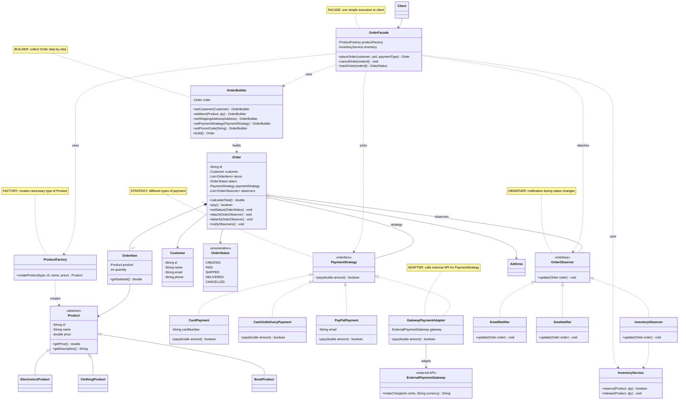

# E-commerce Order — UML Class Diagram

Patterns: **Facade, Builder, Factory, Strategy, Adapter, Observer**

## How Patterns work together

1. `Client` calls only `OrderFacade` that will call `OrderFacade.placeOrder(...)`, `Product` and `Customer`.
2. Facade uses **Factory**, to create `Product`.
3. Facade uses **Builder**, to collect `Order`.
4. Facade chooses **Strategy** payment type (or **Adapter**, if it's external gateway).
5. Facade connects with **Observer**s (Email, SMS, Inventory).
6. When `Order.setStatus(...)` changes, all Observers get `update()`.
