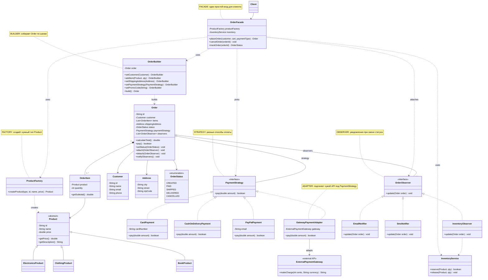

# E-commerce Order — UML Class Diagram

Patterns: **Facade, Builder, Factory, Strategy, Adapter, Observer**

## Как паттерны работают вместе

1. `Client` вызывает только `OrderFacade.placeOrder(...)`.
2. Facade использует **Factory**, чтобы создать `Product`.
3. Facade использует **Builder**, чтобы собрать `Order`.
4. Facade выбирает **Strategy** оплаты (или **Adapter**, если это внешний gateway).
5. Facade подключает **Observer**-ов (Email, SMS, Inventory).
6. Когда `Order.setStatus(...)` меняется, все Observer-ы получают `update()`.